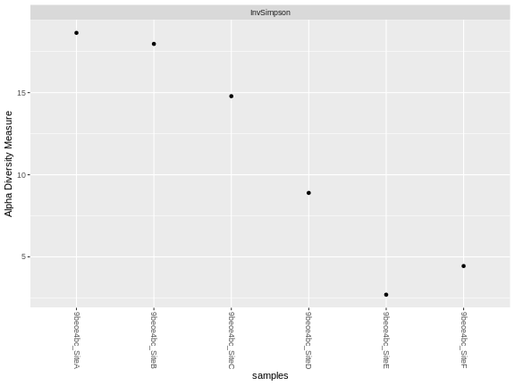
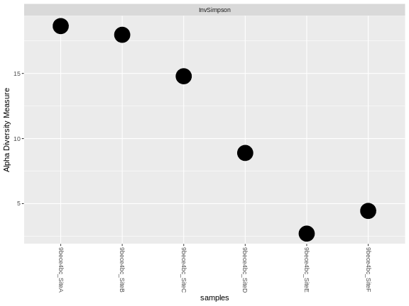
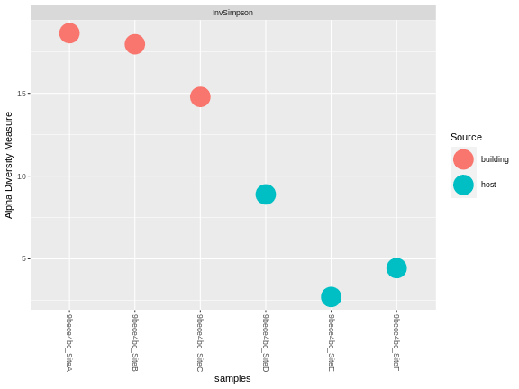
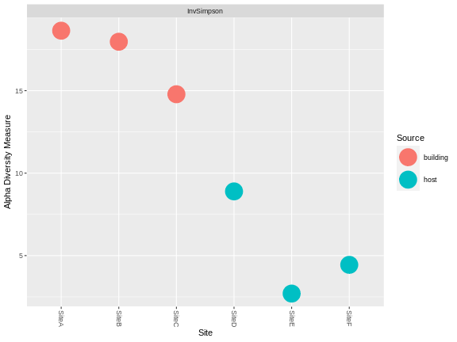
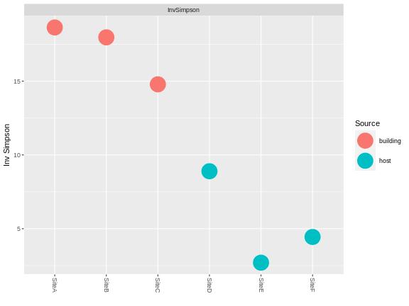
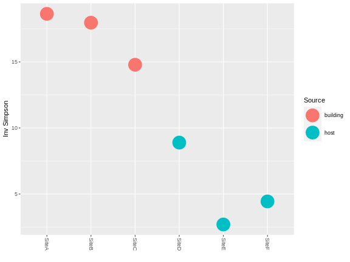
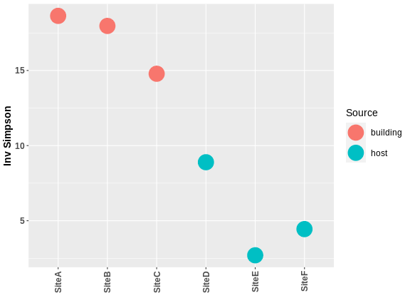

# Alpha Diversity Plot

Alpha diversity describes the diversity *within* a single sample. Here we use the **Inverse Simpson** index, which combines how many taxa are present with how evenly they are spread. Higher numbers mean a more diverse community.

We will build one plot in small steps. Each step repeats the code from the step before and adds one new piece, so you can see exactly what each piece does. These are the same steps as in your `data_analysis_I.qmd` notebook.

In this example, we'll start with a single house data set. We copy the house into a generic container, `mydata`:

```
mydata <- myhouse
```

**1. Start with the basic plot from phyloseq.** `plot_richness()` calculates the index for each sample and plots it.

```
plot_richness(mydata, measures = "InvSimpson")
```



**2. Make the points larger.** `plot_richness()` makes a ggplot, so we can add layers with `+`. Here, `geom_point(size = 10)`:

```
plot_richness(mydata, measures = "InvSimpson") +
  geom_point(size = 10)
```



**3. Add color** to separate the types of sites in the house with `color = "Source"` (building or host):

```
plot_richness(mydata, measures = "InvSimpson",
              color = "Source") +
  geom_point(size = 10)
```



**4. Fix the x-axis labels** with `x = "Site"`, so each point is labeled by its site instead of the sample name:

```
plot_richness(mydata, measures = "InvSimpson",
              color = "Source",
              x = "Site") +
  geom_point(size = 10)
```



**5. Continue to fix the labels** with the `labs()` function:

```
plot_richness(mydata, measures = "InvSimpson",
              color = "Source",
              x = "Site") +
  geom_point(size = 10) +
  labs(x = "", y = "Inv Simpson")
```



**6. Remove the extra label at the top.** This label (the *strip text*) repeats the y-axis title, so we hide it in `theme()`:

```
plot_richness(mydata, measures = "InvSimpson",
              color = "Source",
              x = "Site") +
  geom_point(size = 10) +
  labs(x = "", y = "Inv Simpson") +
  theme(
    strip.text.x = element_blank(),
    strip.background = element_blank()
  )
```



**7. Increase the font size.** The text is still quite small. We can increase and standardize the size in `theme()`:

```
plot_richness(mydata, measures = "InvSimpson",
              color = "Source",
              x = "Site") +
  geom_point(size = 10) +
  labs(x = "", y = "Inv Simpson") +
  theme(
    strip.text.x = element_blank(),
    strip.background = element_blank(),
    axis.text = element_text(size = 12, face = "bold"),
    axis.title = element_text(size = 14, face = "bold"),
    legend.text = element_text(size = 12),
    legend.title = element_text(size = 14)
  )
```


**8. Rotate the x-axis labels.** The site names can overlap. We can turn them sideways in `theme()`:

```
plot_richness(mydata, measures = "InvSimpson",
              color = "Source",
              x = "Site") +
  geom_point(size = 10) +
  labs(x = "", y = "Inv Simpson") +
  theme(
    strip.text.x = element_blank(),
    strip.background = element_blank(),
    axis.text = element_text(size = 12, face = "bold"),
    axis.title = element_text(size = 14, face = "bold"),
    legend.text = element_text(size = 12),
    legend.title = element_text(size = 14),
    axis.text.x = element_text(angle = 90, vjust = 0.5, hjust = 1)
  )
```



**Try it:** *richness* is simply the number of different taxa in a sample. Change `measures = "InvSimpson"` to `measures = c("Observed", "InvSimpson")` to plot richness and Inverse Simpson side by side. Delete the two `strip.` lines so each panel keeps its label. To see the other measures available, run `help("plot_richness")` and look under `measures`.
