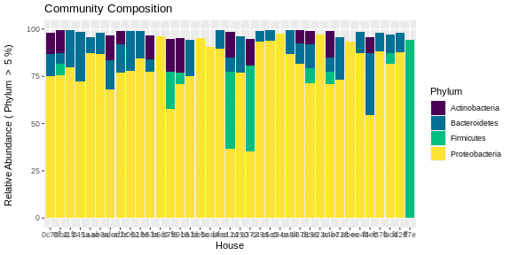
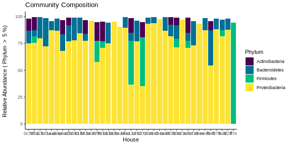
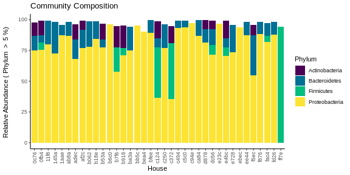
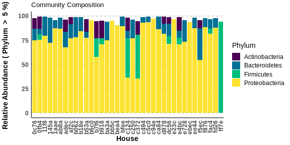
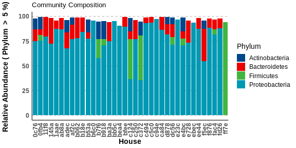
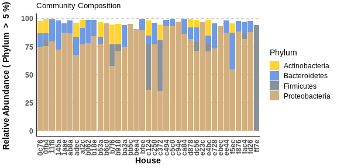

# Stacked Bar Chart: visualize community composition differences

Stacked bar plots show which taxa make up each sample. We will build one in small steps. These are the same steps as in your `data_analysis_I.qmd` notebook. (In the notebook you build it first for your house, with sites on the x-axis. This page uses a site dataset, with houses on the x-axis. The code is the same except for the `x =` setting.)

In this example, we'll start with a single site data set. We copy the site into a generic container, **`mydata`**.

```
mydata <- mysite
```

## Choose your settings

We will combine ASVs at one taxonomic rank. First, create a variable with the rank you want. We'll call this variable **`myTaxLevel`**. In this example, we'll combine at the Phylum level.

```
myTaxLevel <- "Phylum"
```

You should also consider filtering out low-abundance groups. We'll call this variable **`myFilter`**. In this example, we'll hide any group that makes up less than 5% of a sample.

```
myFilter <- 5
```

Now create a text label from these settings, **`myYaxis`**, for the vertical axis. It updates itself whenever you change the settings.

```
myYaxis <- paste0("Relative abundance (", myTaxLevel, " > ", myFilter, "%)")
```

The code below should work for any taxonomic level and any degree of filtering. Change the values of `myTaxLevel` and `myFilter`, then rerun the commands below to make different plots.

## Convert to relative abundance and combine

Samples have different numbers of reads, so start by converting the raw counts into relative abundance, as a percent (0 to 100). This creates a new data set called **`relmydata`**.

```
relmydata <- transform_sample_counts(mydata, function(x) 100 * x / sum(x))
```

Now combine your ASVs. Each line does one step, connected by the pipe `%>%` ("and then"). Your combined data will be in the container called **`relmydata_grouped`**.

```
relmydata_grouped <- relmydata %>%
  tax_glom(taxrank = myTaxLevel) %>%         # combine ASVs at your taxonomic level
  psmelt() %>%                               # turn into one long table for ggplot
  filter(Abundance > myFilter) %>%           # drop taxa below myFilter %
  arrange(.data[[myTaxLevel]])               # sort alphabetically
```

Next, remove ASVs that could not be identified at this level. They are labeled "Unclassified ..." (for example, "Unclassified Bacteroidota"). Your cleaned data will be called **`relmydata_grouped_clean`**.

```
relmydata_grouped_clean <- relmydata_grouped %>%
  filter(!grepl("^Unclassified", .data[[myTaxLevel]]))
```

Next, create a color palette with one color for each group at your taxonomic level. In this example, we use the viridis palette. The colors are stored in a variable called **`mycolors`**.

```
mycolors <- sequential_hcl(length(unique(relmydata_grouped_clean[[myTaxLevel]])), palette = "viridis")
```

## Build the plot

**1. The basic plot.** Put it all together with `ggplot`. Each bar is a sample, split into colored pieces by taxon.

```
ggplot(relmydata_grouped_clean, aes(x = House, y = Abundance, fill = .data[[myTaxLevel]])) +
  geom_bar(stat = "identity") +
  scale_fill_manual(values = mycolors) +
  ylab(myYaxis) +
  ggtitle("Community Composition")
```



**2. A cleaner background.** Adding the classic theme (`theme_classic()`) removes the gray background and adds lines for the axes.

```
ggplot(relmydata_grouped_clean, aes(x = House, y = Abundance, fill = .data[[myTaxLevel]])) +
  geom_bar(stat = "identity") +
  scale_fill_manual(values = mycolors) +
  ylab(myYaxis) +
  ggtitle("Community Composition") +
  theme_classic()
```



**3. Rotate the x-axis labels.** The labels on the horizontal axis overlap. Rotate them with `axis.text.x` in `theme()`.

```
ggplot(relmydata_grouped_clean, aes(x = House, y = Abundance, fill = .data[[myTaxLevel]])) +
  geom_bar(stat = "identity") +
  scale_fill_manual(values = mycolors) +
  ylab(myYaxis) +
  ggtitle("Community Composition") +
  theme_classic() +
  theme(
    axis.text.x = element_text(angle = 90, vjust = 0.5, hjust = 1)
  )
```



**4. Increase the font size.** The text is still quite small. We can increase and standardize the size in `theme()`.

```
ggplot(relmydata_grouped_clean, aes(x = House, y = Abundance, fill = .data[[myTaxLevel]])) +
  geom_bar(stat = "identity") +
  scale_fill_manual(values = mycolors) +
  ylab(myYaxis) +
  ggtitle("Community Composition") +
  theme_classic() +
  theme(
    axis.text.x = element_text(angle = 90, vjust = 0.5, hjust = 1),
    axis.text = element_text(size = 12, face = "bold"),
    axis.title = element_text(size = 14, face = "bold"),
    legend.text = element_text(size = 12),
    legend.title = element_text(size = 14)
  )
```


**5. Add gridlines.** Dashed grid lines make the percentages easier to read. Add them with `panel.grid` in `theme()`.

```
ggplot(relmydata_grouped_clean, aes(x = House, y = Abundance, fill = .data[[myTaxLevel]])) +
  geom_bar(stat = "identity") +
  scale_fill_manual(values = mycolors) +
  ylab(myYaxis) +
  ggtitle("Community Composition") +
  theme_classic() +
  theme(
    axis.text.x = element_text(angle = 90, vjust = 0.5, hjust = 1),
    axis.text = element_text(size = 12, face = "bold"),
    axis.title = element_text(size = 14, face = "bold"),
    legend.text = element_text(size = 12),
    legend.title = element_text(size = 14),
    axis.ticks = element_blank(),
    panel.grid = element_line(color = "#b4aea9"),
    panel.grid.major.y = element_line(linetype = "dashed")
  )
```



**6. Journal color palettes with ggsci.** The [ggsci](https://nanx.me/ggsci/) package has color palettes inspired by scientific journals. Load it with `library(ggsci)`, then replace the `scale_fill_manual()` line with the two functions `scale_color_lancet()` and `scale_fill_lancet()` to use colors like the journal *Lancet*.

```
library(ggsci)

ggplot(relmydata_grouped_clean, aes(x = House, y = Abundance, fill = .data[[myTaxLevel]])) +
  geom_bar(stat = "identity") +
  # scale_fill_manual(values = mycolors) +
  scale_color_lancet() + scale_fill_lancet() +
  ylab(myYaxis) +
  ggtitle("Community Composition") +
  theme_classic() +
  theme(
    axis.text.x = element_text(angle = 90, vjust = 0.5, hjust = 1),
    axis.text = element_text(size = 12, face = "bold"),
    axis.title = element_text(size = 14, face = "bold"),
    legend.text = element_text(size = 12),
    legend.title = element_text(size = 14),
    axis.ticks = element_blank(),
    panel.grid = element_line(color = "#b4aea9"),
    panel.grid.major.y = element_line(linetype = "dashed")
  )
```



**7. Or be a little silly** and use *The Simpsons* palette.

```
ggplot(relmydata_grouped_clean, aes(x = House, y = Abundance, fill = .data[[myTaxLevel]])) +
  geom_bar(stat = "identity") +
  # scale_fill_manual(values = mycolors) +
  # scale_color_lancet() + scale_fill_lancet() +
  scale_color_simpsons() + scale_fill_simpsons() +
  ylab(myYaxis) +
  ggtitle("Community Composition") +
  theme_classic() +
  theme(
    axis.text.x = element_text(angle = 90, vjust = 0.5, hjust = 1),
    axis.text = element_text(size = 12, face = "bold"),
    axis.title = element_text(size = 14, face = "bold"),
    legend.text = element_text(size = 12),
    legend.title = element_text(size = 14),
    axis.ticks = element_blank(),
    panel.grid = element_line(color = "#b4aea9"),
    panel.grid.major.y = element_line(linetype = "dashed")
  )
```



**Running out of colors?** Each ggsci palette has a fixed number of colors: Lancet has 9 and Simpsons has 16. If your plot has more taxa than that, the extra taxa show up as gray bars. Raise `myFilter` or choose a palette with more colors. More palettes are listed at <https://nanx.me/ggsci/>.

**Try it:** change `myTaxLevel` to `"Class"` and then `"Family"`, and rerun the steps from "Convert to relative abundance and combine" onward.
